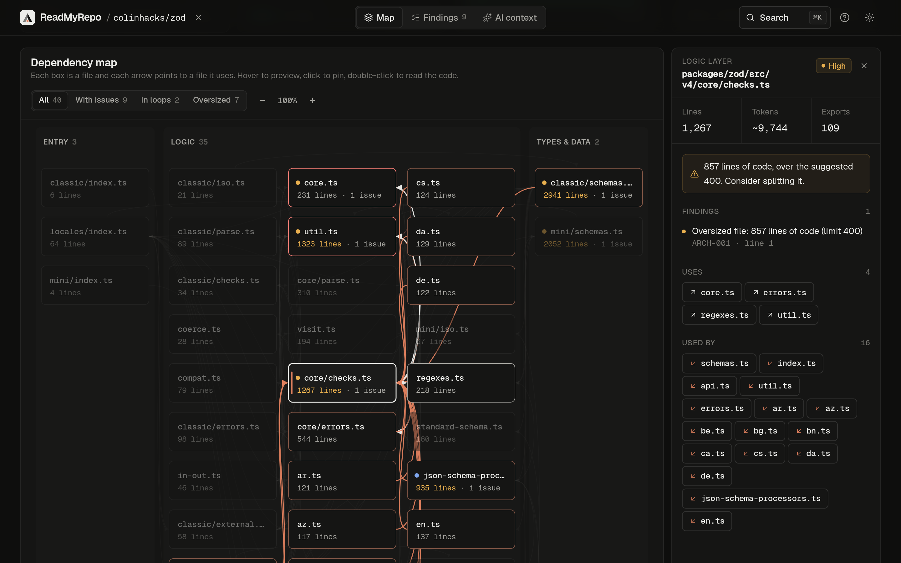
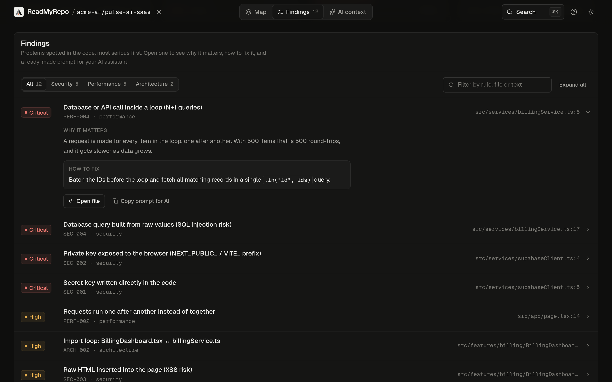

<div align="center">


# ReadMyRepo

**Understand any GitHub repository in seconds.**

See how the files connect, find what is risky or slow, and hand the project to your AI coding assistant.

[](https://readmyrepo.com/?repo=EmmanouelKontos/readmyrepo)
[](LICENSE)

[**readmyrepo.com**](https://readmyrepo.com) · free · no sign-up · runs entirely in your browser

</div>

<br>



## Why

The first hour in an unfamiliar codebase is mostly orientation: which files matter, what depends on what, and where
the problems are. ReadMyRepo answers those questions from a single link, and writes the result down in a form an AI
assistant can use.

## Features

- **Dependency map.** Every file is a box and every arrow points to a file it uses, grouped into layers (entry
  points, features, UI, logic, types and data, config). Hover to preview a file's links, click to pin them.
  Import loops are drawn in red and oversized files in orange.
- **Findings in plain English.** 17 static checks cover leaked secrets, unsafe HTML and SQL, slow request and
  query patterns, import loops and oversized files. Each finding links to the exact line and explains why it
  matters and how to fix it.
- **Scores.** Security, performance and architecture are each scored out of 100, with a short explanation of how
  the numbers are calculated.
- **AI handoff.** A generated `AGENTS.md` describes the project's structure for Claude Code, Cursor, Copilot and
  similar tools, plus a single prompt that lists every problem found, most serious first.
- **Track progress.** Pin a project to compare later scans against the first one, or edit a file in place and
  re-score instantly.
- **Share.** Every public report has a link anyone can open, and a README badge that links back to it.



## Supported languages

| Language | What is resolved |
| --- | --- |
| TypeScript / JavaScript | ESM and CommonJS, path aliases, `.js` to `.ts` mapping, barrel re-exports. Imports that are only used as types are excluded from loop detection, as the compiler removes them. |
| Python | Relative and absolute imports, submodules versus package `__init__`, standard-library names |
| Go | Module paths from `go.mod`, plus links between files of the same package by symbol use |
| Rust | `mod`, grouped `use crate::{…}`, `super::` and `self::` paths |
| C / C++ | Local `#include` headers |
| Chrome extensions | `manifest.json` service workers, content scripts and pages |
| Tauri | Frontend `invoke()` calls to `#[tauri::command]` handlers |

## Checks

| ID | Finds |
| --- | --- |
| SEC-001 | Secret keys written in the code (API keys, privileged JWTs, cloud and Git tokens, private keys) |
| SEC-002 | Secrets exposed to the browser through `NEXT_PUBLIC_` or `VITE_` variables |
| SEC-003 | Raw HTML inserted into the page without sanitising (XSS) |
| SEC-004 | SQL built from raw values (injection); tagged templates and bound parameters are recognised as safe |
| SEC-005 | APIs open to every origin (`Access-Control-Allow-Origin: *`) |
| SEC-006 | Unbounded string copies in C (`strcpy`, `sprintf`, `gets`) |
| SEC-007 | Browser extensions requesting access to every website |
| SEC-008 | Tauri or Electron security settings turned off |
| PERF-001 | Large pages shipped to the browser with a top-level `"use client"` |
| PERF-002 | Independent requests awaited one after another |
| PERF-003 | Index files re-exporting many modules with `export *` |
| PERF-004 | A database or API call per item in a loop (N+1) |
| PERF-005 | Queries that load every row and column |
| PERF-006 | Busy-waits in C and `unsafe` Rust blocks without a safety note |
| ARCH-001 | Oversized files (more than 220 lines of code for UI components, 400 for logic, 800 for C, C++, Rust and Go) |
| ARCH-002 | Import loops (circular dependencies) |
| ARCH-003 | Low-level files that depend on higher-level ones |

The checks are pattern-based static analysis, tuned against a few dozen real open-source repositories to keep false
positives low. They point you at likely problems; they are not a replacement for a security audit.

## How it works

ReadMyRepo is a static web app with no backend. The browser asks the GitHub API for the repository's file list,
downloads the files directly from `raw.githubusercontent.com`, and analyses them locally. Nothing is uploaded or
stored on a server.

- **Large repositories are sampled.** Up to 44 of the most connected source files are analysed: a stratified
  sample by folder, completed with the files that sample imports most. The report always says how much was read.
- **GitHub rate limits apply per visitor.** A scan uses 2 to 6 API requests, so anonymous visitors can run roughly
  10 to 30 scans an hour. When the limit is reached, public repositories still load through the
  [ungh.cc](https://ungh.cc) mirror.
- **Private repositories** can be scanned with a read-only fine-grained token. The token stays in the open tab,
  is sent only to `api.github.com`, and is never stored.

## Running locally

Requires [Bun](https://bun.sh) 1.1 or later.

```bash
git clone https://github.com/EmmanouelKontos/readmyrepo.git
cd readmyrepo
bun install
bun run dev        # http://localhost:5173
```

| Command | Description |
| --- | --- |
| `bun run dev` | Start the development server |
| `bun test` | Run the test suite |
| `bun run build` | Type-check and build to `dist/` |
| `bun run preview` | Serve the production build locally |

## Project structure

```text
src/
├── components/     Shared UI: layout, dialogs and design primitives
├── features/       Views: dependency map, findings, AI handoff, code inspector
├── hooks/          URL state, colour scheme, element measurement
├── lib/            Analysis engine: fetching, import resolution, checks, scoring
├── fixtures/       Example projects shown on the home page (excluded from scans)
└── types/          Shared types
tests/              Analyzer, resolver and scoring tests
public/             Icons, headers, redirects, robots.txt and sitemap
```

## Deployment

The production site runs on Cloudflare Pages. `public/_headers` sets a strict Content Security Policy
(`script-src 'self'`, network access limited to GitHub and the mirror) and the other security headers.

```bash
bun run build
bunx wrangler pages deploy dist --project-name readmyrepo
```

Any static host works if it serves `index.html` for unknown paths and applies equivalent headers.

## Contributing

Bug reports and pull requests are welcome. False positives and missed imports are the most useful reports:
include the repository (or a minimal example) and what you expected to see. Please run `bun test` and
`bun run build` before opening a pull request.

## License

[MIT](LICENSE) © Emmanouil Kontos

If ReadMyRepo saves you time, you can [buy me a coffee](https://buymeacoffee.com/emmanouilkontos).
