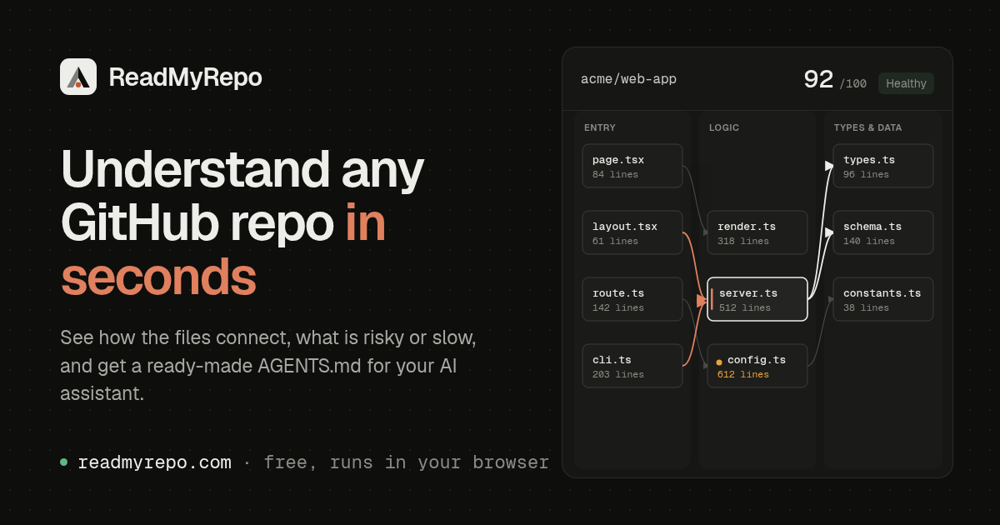

# ReadMyRepo

**Try it: [readmyrepo.com](https://readmyrepo.com)** · free, open source, no sign-up

[](https://readmyrepo.com)

**See how a codebase fits together.** Paste any GitHub repository (or open a folder on your computer) and ReadMyRepo
shows you:

- **A map of the code** — which files use which, grouped by role, with import loops and oversized files highlighted.
- **What could be risky or slow** — 17 checks for leaked keys, unsafe HTML and SQL, slow database patterns and messy
  structure, each explained in plain words with a fix.
- **A guide for your AI coding assistant** — a ready-made `AGENTS.md` plus one prompt that fixes everything found.

Everything runs in your browser: there is no server, and your code is never uploaded.

---

## Key Capabilities

- **Multi-Language Dependency Graph**:
  - Resolves cross-file dependencies across **TypeScript / JavaScript** (ESM, CommonJS, tsconfig aliases, `.js` → `.ts`, barrel re-exports), **Python** (relative and absolute imports, submodule vs. package `__init__`), **Go** (`go.mod` module paths plus symbol-level links between files of one package), **Rust** (`mod`, grouped `use crate::{…}`, `super::` / `self::`), **C / C++** (`#include`), **Chrome Extensions (MV3)** (`manifest.json` → service worker & content scripts) and **Tauri v2** (`invoke('cmd')` → `#[tauri::command]`).
  - Type-only imports (explicit `import type` *and* bindings TypeScript erases because they are only used as types) are kept out of cycle detection, so reported cycles are runtime cycles.
  - Large repositories are sampled by directory, then the sample is completed with the hub modules it imports (shared headers, utils, base classes) so the graph stays connected.
  - Interactive SVG map with zoom, layer lanes that wrap busy layers into columns, 1-hop dependency spotlight and cycle highlighting (Tarjan SCC).
- **Static Analysis Engine**:
  - Comment-aware scanning with **8 Security Rules** (`SEC-001`–`SEC-008`), **6 Performance Rules** (`PERF-001`–`PERF-006`) and **3 Architecture Rules** (`ARCH-001` oversized module — 220 code lines for UI components, 400 for logic modules, 800 for C/C++/Rust/Go; `ARCH-002` circular dependency; `ARCH-003` upward layer inversion).
- **Live In-Browser Remediation & Score Delta Tracking**:
  - Inspect any module in the **Live Code Inspector**, apply a 1-click **"Simulate AI Fix & Re-Scan"** or edit code directly, and watch Architecture, Security, Performance, and Token Footprint deltas update in real time.
- **Persistent Pinned Projects (Two-Tier Browser Cache)**:
  - Pin any scanned repository to store lightweight metadata in `localStorage` and full file snapshots in **IndexedDB** (`repo-atlas-idb-v1`) for instant offline reload and baseline score comparison.
- **Zero-Trust Privacy & Private Repository Support**:
  - Fine-grained GitHub Personal Access Tokens (`github_pat_...` / `ghp_...`) are held strictly in volatile React memory (`credentials: 'omit'`), validated against strict format and outbound host allowlists (`api.github.com`, `raw.githubusercontent.com`, `ungh.cc`), and never persisted to disk.

---

## Local Development

```bash
# Install dependencies
bun install

# Start local development server
bun run dev

# Run the analyzer test suite
bun test

# Build production bundle
bun run build
```

---

## Deploying to Cloudflare Pages

ReadMyRepo is a pure static SPA with pre-configured Cloudflare Pages headers (`public/_headers`) and SPA routing (`public/_redirects`):

```bash
bun run build
bunx wrangler pages deploy dist --project-name readmyrepo
```

### How it scales

There is no backend. Cloudflare serves static files (free and unmetered on the Pages free plan), and every
visitor's browser talks to GitHub directly, so each visitor has their own GitHub quota:

- **API requests per scan:** 2–6 (repository info plus file listings). File contents come from
  `raw.githubusercontent.com`, which does not count against the API quota — also when a token is used, unless the
  repository is private.
- **Anonymous visitors:** GitHub allows about 60 API requests per hour per IP, so roughly 10–30 scans per hour.
  When that runs out, public repositories still load through the `ungh.cc` tree mirror + raw files.
- **With a token:** 5,000 requests per hour for that visitor.
- **Downloads** run at most 8 at a time to stay clear of GitHub's abuse limits.

### Security

- Strict Content-Security-Policy in production (`public/_headers` + the in-page policy added at build time):
  `script-src 'self'`, network access only to `api.github.com`, `raw.githubusercontent.com` and `ungh.cc`,
  no framing, no plugins.
- Repository content is only ever rendered as text; no `innerHTML` anywhere in the app.
- Tokens stay in memory for the tab, are sent only to `api.github.com`, and are never written to storage or the URL.
- Every analyzer regex is bounded and linear-time on untrusted input (fuzzed with 160 KB adversarial files).

## Support & license

Made by [Emmanouil Kontos](https://github.com/EmmanouelKontos). If ReadMyRepo helps you, you can
[buy me a coffee](https://buymeacoffee.com/emmanouilkontos).

Released under the [MIT License](LICENSE).

